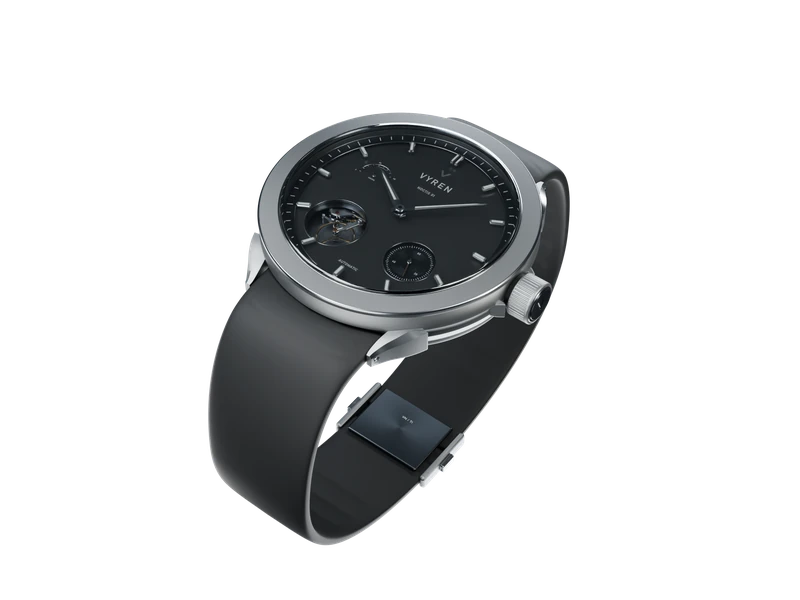

# VYREN / NOCTIS 01

An immersive, scroll-driven website for the fictional VYREN NOCTIS 01 watch. Original Blender geometry, Cycles photography and interactive 3D form a nine-chapter product journey.



## Run locally

Requires Node.js 20.9 or later and npm.

```bash
git clone https://github.com/3bdallahMa7moud/vyren-website.git
cd vyren-website
npm ci
npm run dev
```

Open [http://127.0.0.1:3000](http://127.0.0.1:3000). Web images and the model are included in `public/assets`; Blender is not needed to run the website.

## The experience

| Chapter | Experience |
| --- | --- |
| 01 — Time, redefined | Static studio photography, masked typography and a restrained scroll departure. |
| 02 — Every second has a story | Ivory editorial composition, moving typography and a dark exit curtain. |
| 03 — Sculpted from precision | Nine genuine lighting frames, moving metal crops and a separate crown camera view. |
| 04 — The art of motion | A 48-frame Cycles camera approach into the open-heart mechanism, with balance and hairspring motion. |
| 05 — Every detail, in its place | A 161-frame Cycles assembly sequence, component annotations and exact reassembly. |
| 06 — Built to be felt | Titanium, sapphire, anthracite and rubber studies; horizontal on desktop and vertical on mobile. |
| 07 — Make time yours | A 72-frame photographic Studio orbit, angle presets, detail inspection and Free 3D using the original GLB. |
| 08 — Precision in every form | Front photography dissolves into a mesh-projected blueprint and a verified 41 mm case dimension. |
| 09 — Own the moment | A 72-frame Cycles reveal, a real 20-degree camera turn and a closing Studio action. |

Eight reversible scroll handoffs connect the chapters without extra scroll distance. Studio interactions preserve the visitor's chosen angle.

## Build and checks

```bash
npm run build
npm run typecheck
npm run lint
npm start
```

Browser checks use Playwright and Microsoft Edge. Commands and configurations are in `package.json`, `playwright*.config.ts`, `scripts` and `qa`. Screenshots, recordings, logs and local build caches are excluded from Git.

The latest transition verification covers desktop, mobile, a short browser window and reduced motion. Checks include forward and reverse scrolling, idle frames, bounded frame caches, preserved Studio angles, assembly annotations and final-scene containment. Free 3D controls were also checked on desktop and mobile. See [the transition report](CHAPTER_TRANSITIONS_REPORT_AR.md), [the finale report](FINALE_REVEAL_REPORT_AR.md) and retained JSON records in `qa`.

## Architecture

- Next.js App Router, React and strict TypeScript.
- GSAP/ScrollTrigger choreography and Lenis desktop scrolling.
- Responsive WebP frames, bounded decoded-image caches and offscreen release.
- Three.js inspection of the same original watch model.
- Locally packaged Manrope and Cormorant Garamond fonts.
- Keyboard controls, visible focus, mobile navigation and reduced-motion presentations.

`src/components/landing.tsx` defines the chapters. `motion.ts` and `chapter-transitions.ts` coordinate the scroll journey. `cycles-surface.tsx` and `src/lib/cycles-sequence.ts` present the photographic sequences. `studio-viewer.tsx` provides the Studio; `finale-scene.tsx` owns the closing reveal.

## Assets and authoring

Product imagery comes from the original VYREN Blender master and genuine Cycles renders. No substitute watch, stock product or AI-generated replacement is used. Asset manifests retain rendering provenance and frame metadata.

The original Blender project, high-resolution renders and authoring backups are stored separately from this website repository. Render and packing scripts retain the author's local paths and require those source files when regenerating assets. They are not required to run or deploy the website.

## Hosting

Use a host that supports Next.js. Set `NEXT_PUBLIC_SITE_URL` to the deployment origin before building. `VYREN_BUILD_DIR` optionally selects a separate local build output; the default is `.next`.

This is a fictional design exploration. Material and mechanism names describe visual intent; no manufactured performance, certification or purchase availability is claimed.
